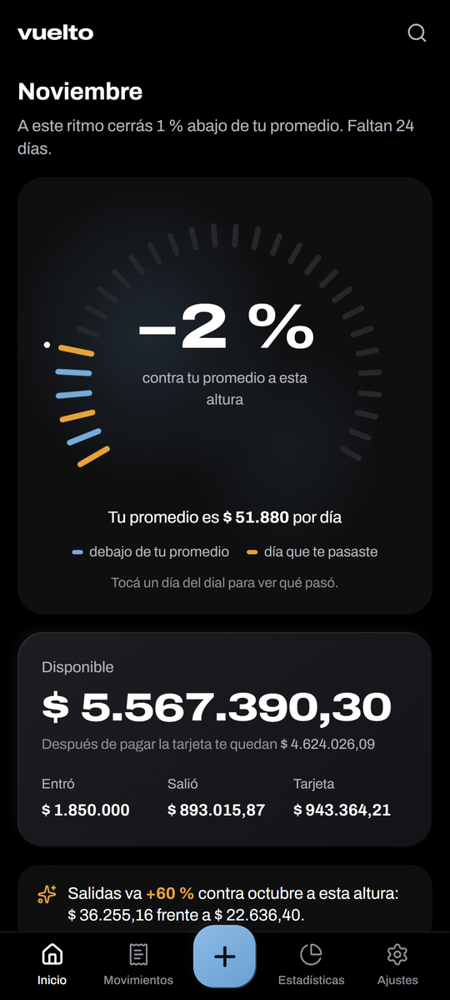
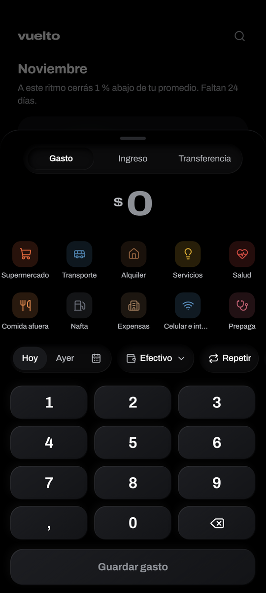
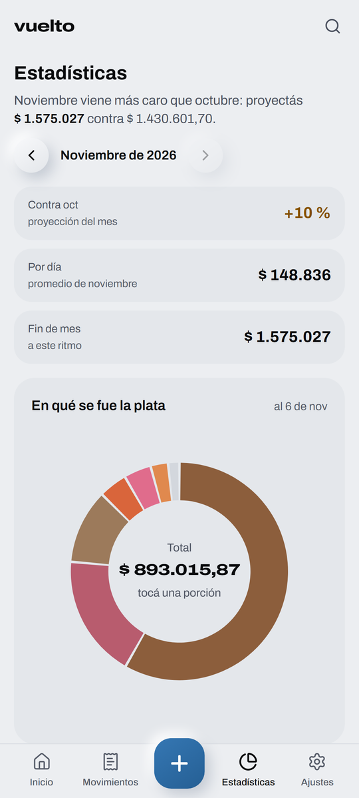
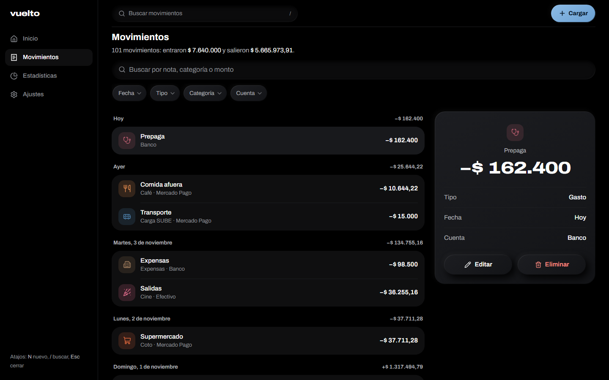

# Vuelto

App de gastos personales para el celular, la tablet y la compu. Funciona offline, se instala como app (PWA) y guarda todo en tu dispositivo. Si querés, sincroniza con una carpeta privada de tu Google Drive y muestra tu cuenta de InvertirOnline en modo lectura.

<p>
  
  
  
</p>


## Qué hace

- **Cargar un gasto en segundos:** monto, categoría y listo. Recuerda la última categoría y cuenta; favoritos de un toque; teclado físico en la compu.
- **Inicio con un dial del mes:** cada día contra tu presupuesto o tu promedio (comparado con lo que llevabas gastado a la misma altura de los meses anteriores). Tocá un día para ver qué pasó. Saldo, deuda de tarjeta aparte, un dato del mes y bloques que se ordenan a gusto.
- **Movimientos:** búsqueda, filtros, `#etiquetas`, deslizar para editar o borrar con "Deshacer", y en escritorio el detalle al costado.
- **Estadísticas:** proyección de fin de mes, dona por categoría, 12 meses con el promedio de los últimos 3, calendario de gasto y día de la semana.
- **Dinero real:** transferencias, cuotas (borrar una o todas), recurrentes que se cargan solos, presupuestos por categoría con aviso al 80 % y al 100 %, gastos compartidos, metas de ahorro y cuentas en dólares con la cotización del día (oficial, blue o MEP).
- **Sincronización opcional** con Google Drive (`appDataFolder`), sin servidor propio. Paso a paso en [`docs/google-setup.md`](docs/google-setup.md).
- **IOL — Inversiones** en modo lectura vía el conector MCP oficial: saldo, portafolio y patrimonio total. Ver [`docs/iol-setup.md`](docs/iol-setup.md).
- Búsqueda global (`Ctrl+K` o `/`), atajos (`N` nuevo, `Esc` cerrar), tema claro y oscuro, "Reducir animaciones" y backup en JSON o CSV.

## Stack

Vite · React 19 · TypeScript · Tailwind CSS v4 · Dexie (IndexedDB) · Zustand · Motion · React Router · Radix Dialog · TanStack Virtual · vite-plugin-pwa · Vitest · Playwright. Funciones de Vercel en `api/` para IOL.

El dinero se maneja siempre en centavos enteros (`src/lib/money.ts`).

## Correrlo

```bash
npm install
npm run dev
```

| Comando             | Qué hace                                                        |
| ------------------- | --------------------------------------------------------------- |
| `npm run build`     | Build de producción en `dist/`                                  |
| `npm run preview`   | Sirve el build (hace falta para probar el service worker)       |
| `npm run typecheck` | Chequeo de tipos (app, funciones y tests)                       |
| `npm run lint`      | ESLint                                                          |
| `npm test`          | Tests unitarios                                                 |
| `npm run e2e`       | End-to-end en 5 dispositivos (iOS, Android, 360 px, tablet, PC) |

Para los e2e hace falta instalar los navegadores una vez: `npx playwright install chromium webkit`.

## Variables de entorno

Todas opcionales. Sin ellas, la app funciona solo en el dispositivo.

| Variable                | Para qué                                        |
| ----------------------- | ----------------------------------------------- |
| `VITE_GOOGLE_CLIENT_ID` | Login con Google y sincronización con Drive     |
| `GOOGLE_CLIENT_ID`      | Lo mismo, del lado de las funciones de IOL      |
| `IOL_CLIENT_ID`         | Cliente registrado en IOL                       |
| `IOL_TOKEN_KEY`         | Clave (32 bytes en base64) que sella los tokens |

## Deploy

En Vercel, con framework **Vite**. `vercel.json` resuelve el fallback de rutas y el cacheo del service worker; las funciones de `api/` se publican solas.

## Privacidad

Ver [`/privacidad`](https://vuelto-gestor-gastos.vercel.app/privacidad): qué queda en tu dispositivo, qué va a tu Drive y qué ve IOL.
